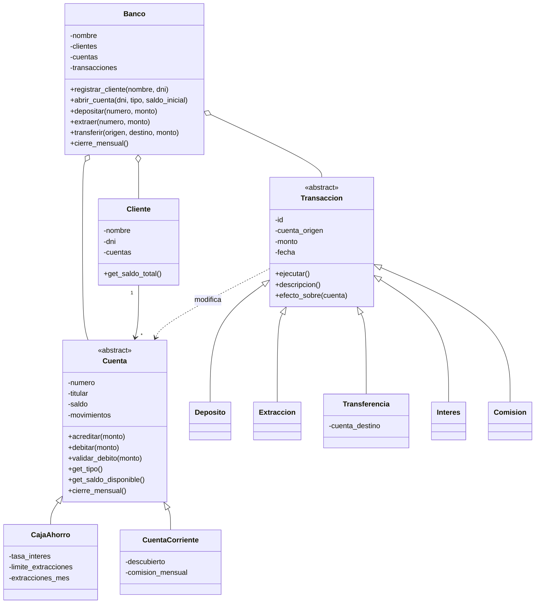

# 🏦 Mini Banco


Sistema bancario por consola para practicar **Programación Orientada a Objetos** en Python: clientes, cuentas de distintos tipos, transacciones, un menú interactivo y reportes en PDF.

> [!NOTE]
> Los datos se guardan en **listas en memoria**. Al cerrar el programa se pierden; para conservarlos hay que generar el reporte PDF antes de salir.

## 📑 Contenido

- [Descripción](#-descripción)
- [Características](#-características)
- [Principios de POO aplicados](#-principios-de-poo-aplicados)
- [Estructura del proyecto](#-estructura-del-proyecto)
- [Instalación](#-instalación-y-puesta-en-marcha)
- [Uso](#-uso)
- [Diagrama de clases](#-diagrama-de-clases)
- [Manejo de errores](#-manejo-de-errores)
- [Pruebas](#-pruebas)
- [Reporte en PDF](#-reporte-en-pdf)
- [Ejemplo de sesión](#-ejemplo-de-sesión)
- [Próximos pasos](#-próximos-pasos)

## 📖 Descripción

El banco administra **clientes** que pueden abrir **cuentas** (caja de ahorro o cuenta corriente) y realizar **transacciones** (depósitos, extracciones y transferencias). Cada tipo de cuenta tiene sus propias reglas:

| Cuenta | Reglas |
| --- | --- |
| **Caja de Ahorro** | Paga un interés mensual (1 % por defecto) y permite hasta 5 extracciones por mes. No admite saldo negativo. |
| **Cuenta Corriente** | Permite quedar en descubierto (hasta \$ 5.000 por defecto) y cobra una comisión mensual de mantenimiento (\$ 150 por defecto). Sin límite de extracciones. |

El **cierre mensual** acredita los intereses de las cajas de ahorro y cobra las comisiones de las cuentas corrientes: la misma llamada produce resultados distintos según el tipo de cuenta.

## ✨ Características

- ✅ Entorno virtual (`venv`) y dependencias en `requirements.txt`.
- ✅ Menú interactivo para cargar datos, consultarlos y ejecutar operaciones.
- ✅ Reporte del sistema en **PDF** (resumen, clientes, cuentas y transacciones).
- ✅ Validación de datos y manejo de errores con `try` / `except` y excepciones propias.
- ✅ Datos almacenados en arreglos (listas) en memoria.
- ✅ 293 pruebas unitarias con **pytest** y 100 % de cobertura.

## 🧠 Principios de POO aplicados

| Principio | Dónde se aplica |
| --- | --- |
| **Abstracción** | Entidades `Banco`, `Cliente`, `Cuenta` y `Transaccion`. `Cuenta` y `Transaccion` son clases abstractas (`ABC`) que definen *qué* hay que hacer sin decir *cómo*. |
| **Herencia** | `CajaAhorro` y `CuentaCorriente` heredan de `Cuenta`. `Deposito`, `Extraccion`, `Transferencia`, `Interes` y `Comision` heredan de `Transaccion`. |
| **Polimorfismo** | Cada subclase redefine `get_tipo()`, `get_saldo_disponible()`, `validar_debito()`, `cierre_mensual()`, `descripcion()` y `efecto_sobre()`. El código que usa una `Cuenta` o una `Transaccion` no necesita saber de qué tipo es. |
| **Encapsulamiento** | Todos los atributos son privados (`self.__saldo`, `self.__nombre`, …) y se leen o modifican solo con métodos `get_*` y `set_*` que validan el dato. |

> [!TIP]
> Un buen ejemplo de polimorfismo está en `Banco.cierre_mensual()`: recorre todas las cuentas y llama a `cuenta.cierre_mensual()` sin preguntar de qué clase es cada una.

## 🗂️ Estructura del proyecto

```text
Laboratorio-final-integrador/
├── main.py                  # Punto de entrada
├── requirements.txt         # Dependencias
├── pytest.ini               # Configuración de pytest
├── README.md
├── .gitignore
├── mini_banco/              # Paquete principal
│   ├── banco.py             # Banco: coordina clientes, cuentas y transacciones
│   ├── cliente.py           # Cliente
│   ├── cuenta.py            # Cuenta (abstracta), CajaAhorro, CuentaCorriente
│   ├── transaccion.py       # Transaccion (abstracta) y sus subclases
│   ├── excepciones.py       # Excepciones propias
│   ├── validaciones.py      # Funciones de validación
│   ├── reportes.py          # Generación del PDF
│   ├── datos_demo.py        # Datos de ejemplo
│   └── menu.py              # Menú interactivo
└── tests/                   # Pruebas unitarias con pytest
```

## 🚀 Instalación y puesta en marcha

**Requisitos:** Python 3.10 o superior.

1. Cloná o descargá el proyecto y entrá a la carpeta:

   ```bash
   cd Laboratorio-final-integrador
   ```

2. Creá el entorno virtual:

   ```bash
   python -m venv venv
   ```

3. Activalo según tu sistema operativo:

   | Sistema | Comando |
   | --- | --- |
   | Windows (PowerShell) | `venv\Scripts\Activate.ps1` |
   | Windows (CMD) | `venv\Scripts\activate.bat` |
   | macOS / Linux | `source venv/bin/activate` |

4. Instalá las dependencias:

   ```bash
   pip install -r requirements.txt
   ```

5. Ejecutá el programa:

   ```bash
   python main.py
   ```

> [!IMPORTANT]
> Recordá activar el entorno virtual cada vez que abras una terminal nueva. Para salir de él, escribí `deactivate`.

## 🖥️ Uso

Al iniciar se muestra el menú principal:

| Opción | Acción |
| :---: | --- |
| `1` | Registrar cliente |
| `2` | Listar clientes |
| `3` | Abrir cuenta (ahorro o corriente) |
| `4` | Listar cuentas |
| `5` | Depositar |
| `6` | Extraer |
| `7` | Transferir entre cuentas |
| `8` | Ver movimientos de una cuenta |
| `9` | Cierre mensual (intereses y comisiones) |
| `10` | Guardar reporte en PDF |
| `11` | Cargar datos de ejemplo |
| `0` | Salir |

> [!TIP]
> Si querés probar rápido, elegí la opción `11` para cargar clientes, cuentas y movimientos de ejemplo.

## 🧬 Diagrama de clases



## ⚠️ Manejo de errores

Todas las excepciones del sistema heredan de `BancoError`, y el menú las captura con `try` / `except` para informar el problema sin cerrar el programa.

| Excepción | Cuándo ocurre |
| --- | --- |
| `DatoInvalidoError` | Un texto vacío, un DNI mal formado o un tipo de cuenta desconocido. |
| `MontoInvalidoError` | El monto no es un número o no es mayor a cero. |
| `SaldoInsuficienteError` | La cuenta no tiene fondos (o supera el descubierto). |
| `LimiteExtraccionesError` | Una caja de ahorro superó las extracciones del mes. |
| `ClienteNoEncontradoError` | No existe un cliente con ese DNI. |
| `CuentaNoEncontradaError` | No existe una cuenta con ese número. |
| `DuplicadoError` | Se intentó registrar un DNI que ya existe. |
| `OperacionInvalidaError` | Se intentó ejecutar dos veces o modificar una transacción ya ejecutada. |
| `ReporteError` | No se pudo guardar el PDF (ruta inválida, sin permisos, etc.). |

```python
try:
    banco.extraer("AH-0001", 999999)
except SaldoInsuficienteError as error:
    print(f"[ERROR] {error}")
```

## 🧪 Pruebas

Las pruebas usan **pytest** y cubren cada función y método del proyecto.

```bash
# Ejecutar todas las pruebas
pytest

# Con más detalle
pytest -v

# Con reporte de cobertura
pytest --cov=mini_banco --cov=main --cov-report=term-missing
```

<details>
<summary>📂 Archivos de prueba</summary>

| Archivo | Qué prueba |
| --- | --- |
| `test_validaciones.py` | Validaciones de números, montos, textos y DNI |
| `test_excepciones.py` | Jerarquía de excepciones |
| `test_cliente.py` | Clase `Cliente` |
| `test_cuenta.py` | `Cuenta`, `CajaAhorro` y `CuentaCorriente` (incluido el polimorfismo) |
| `test_transaccion.py` | `Transaccion` y todas sus subclases |
| `test_banco.py` | Clase `Banco` |
| `test_reportes.py` | Formatos y generación del PDF |
| `test_menu.py` | Menú interactivo (simulando el teclado) |
| `test_datos_demo.py` | Carga de datos de ejemplo |
| `test_main.py` | Punto de entrada |

</details>

## 📄 Reporte en PDF

La opción `10` del menú genera un PDF en la carpeta `reportes/` con:

1. Descripción del sistema.
2. Resumen general (clientes, cuentas, transacciones y saldo total).
3. Tabla de clientes con su saldo total.
4. Tabla de cuentas con sus condiciones.
5. Historial de transacciones.

## 💡 Ejemplo de sesión

<details>
<summary>Ver ejemplo</summary>

```text
====================================================
  MINI BANCO
====================================================
   1. Registrar cliente
   ...
Elegí una opción: 1
Nombre completo: Ana Gómez
DNI (7 u 8 dígitos): 30123456
Cliente registrado: Ana Gómez (DNI 30123456)

Elegí una opción: 3
DNI del titular: 30123456
Tipo de cuenta (ahorro/corriente): ahorro
Depósito inicial (0 para ninguno): 50000
Cuenta abierta: Caja de Ahorro AH-0001 - saldo 50000.00

Elegí una opción: 6
Número de cuenta: AH-0001
Monto a extraer: 999999
[ERROR] Saldo insuficiente en AH-0001: disponible 50000.00.
```

</details>

## 🗺️ Próximos pasos

- [x] Cuentas de ahorro y corrientes con reglas distintas
- [x] Transferencias entre cuentas
- [x] Reporte en PDF
- [ ] Guardar los datos en un archivo o base de datos
- [ ] Agregar préstamos como nuevo tipo de producto
- [ ] Interfaz gráfica

## 👤 Autor

Proyecto académico de Programación Orientada a Objetos.

**Verónica Ricard** - Técnico Superior en DevOps, ITS Cipolletti

GitHub: [@veroricard](https://github.com/veroricard)